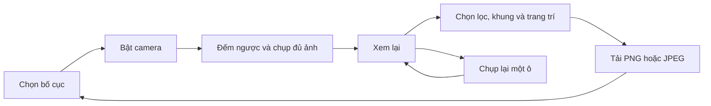

# Kế hoạch xây dựng Photobooth

Ngày lập: 14/10/2026. Tên repo: `photobooth`. Trạng thái: P0 đã được chấp nhận; P1 đã chốt phạm vi và chờ triển khai.

### Trạng thái triển khai ngày 14/10/2026

- Đã dựng React/TypeScript/Vite và hoàn thiện luồng UI cho 3 bố cục.
- Đã tích hợp camera, đếm ngược, chụp liên tiếp, hủy và chụp lại từng ảnh.
- Đã có 6 bộ lọc, 6 frame, caption, ngày, sticker kéo thả và xuất PNG/JPEG.
- Đã kết nối project Supabase `Photobooth`, tạo bảng `photobooth_frames`, bucket `photobooth-frames`, RLS và 6 frame khởi đầu.
- Build production, kiểm tra desktop/mobile và security advisor đã đạt. Kiểm tra camera thật trên Android/iPhone vẫn thuộc bước nghiệm thu thiết bị.

## 1. Mục tiêu sản phẩm

Tạo một website photobooth giúp người dùng **chọn bố cục → chụp một bộ ảnh → chỉnh nhẹ → tải ảnh hoàn chỉnh** ngay trong trình duyệt.

Điểm hấp dẫn là cảm giác chụp tại booth: đếm ngược rõ ràng, đổi dáng giữa các lần chụp, dải ảnh đẹp và thao tác ít. Mọi tính năng phải phục vụ trực tiếp việc tạo bộ ảnh này.

- Dùng được ngay, không cần đăng nhập hoặc cài ứng dụng.
- Ưu tiên điện thoại, đồng thời dùng tốt với webcam trên laptop.
- Giao diện tiếng Việt; tên nút và hướng dẫn ngắn, dễ hiểu.
- Ảnh được xử lý trên thiết bị và chỉ tải xuống khi người dùng yêu cầu.
- Ảnh của người dùng không cần backend và luôn được xử lý cục bộ. Danh mục frame, cấu hình frame và file PNG/SVG của frame được lưu trên Supabase để có thể cập nhật mà không cần build lại website.

Repo local nằm tại `E:\SeriousProject\Photobooth`. Tạo remote GitHub và triển khai website công khai là các bước phát hành sau khi nghiệm thu camera trên thiết bị thật.

## 2. Những gì đã kiểm tra ở repo tham chiếu

Nguồn: [htungitmo420/sticker-studio](https://github.com/htungitmo420/sticker-studio), nhánh `main`, commit `800176450ba7478d0ff1b314aee241f4fe47ce74`.

Đã đọc README, mã photobooth và tiện ích bố cục. Các nhận xét dưới đây dựa trên mã nguồn; chưa kiểm thử website chạy thực tế.

| Phần tham chiếu | Điểm đáng giữ | Cách áp dụng cho repo mới |
| --- | --- | --- |
| Camera trực tiếp | Camera trước/sau, ảnh gương, đếm ngược | Giữ, bổ sung trạng thái xin quyền và lỗi rõ ràng |
| Chụp nhiều ảnh | Chụp liên tiếp và xem lại kết quả | Chụp đúng số ô của bố cục, đếm ngược trước từng ảnh |
| Bố cục ảnh | Dải 4 ảnh, lưới 2×2, Polaroid, film strip, dải 3 ảnh có banner | Bản đầu chọn 3 bố cục phổ biến, không làm thư viện bố cục quá lớn |
| Khung và nền | Màu nền, viền, preset phối hợp nhanh | Dùng bộ khung chọn sẵn, thumbnail có ảnh minh họa |
| Bộ lọc | Các phong cách màu cho ảnh | Chọn 6 bộ lọc sau khi chụp, áp dụng cho cả bộ |
| Chữ và emoji | Tạo dấu ấn cá nhân cho dải ảnh | Caption, ngày chụp và một bộ sticker nhỏ |
| Xuất ảnh | Ghép ảnh, khung và lớp trang trí thành file | Giữ PNG/JPEG, bảo đảm file xuất khớp bản xem trước |
| Khung tùy chỉnh | PNG có vùng trong suốt và các ô ảnh | Để giai đoạn sau; bản đầu chỉ dùng khung tích hợp |

Các điểm cần cải thiện khi thiết kế mới:

- `PhotoboothClient.tsx` chứa hơn 2.000 dòng và phụ thuộc editor khung, AR, overlay và API khung. Repo mới tách camera, phiên chụp, bố cục và xuất ảnh thành các module nhỏ.
- Chế độ burst hiện chụp thêm 2 ảnh so với số ô; bản mới chụp đủ số ô và cho chụp lại từng ô để giảm bước chọn ảnh.
- Camera hiện gom các lỗi vào một thông báo chung; bản mới phân biệt từ chối quyền, không có camera và thiết bị đang không khả dụng.
- Bộ lọc xem trước camera trong mã tham chiếu là các phép xấp xỉ CSS. Bản đầu mới giữ camera tự nhiên, áp dụng bộ lọc ở bước xem lại bằng cùng bộ xử lý dùng khi xuất.
- Xuất ảnh trong mã tham chiếu có khoảng chờ hiệu ứng cố định; bản mới hiển thị tiến trình theo công việc thực tế và tải ngay khi sẵn sàng.

Nguồn chi tiết: [mã photobooth](https://github.com/htungitmo420/sticker-studio/blob/800176450ba7478d0ff1b314aee241f4fe47ce74/app/%28studio%29/photobooth/PhotoboothClient.tsx), [bố cục và preset](https://github.com/htungitmo420/sticker-studio/blob/800176450ba7478d0ff1b314aee241f4fe47ce74/app/%28studio%29/photobooth/booth-utils.ts), [README](https://github.com/htungitmo420/sticker-studio/blob/800176450ba7478d0ff1b314aee241f4fe47ce74/README.md).

Hướng triển khai là viết mã mới từ trải nghiệm đã chọn. Khi khảo sát chưa thấy file LICENSE trong cây repo và GitHub trả `license: null`; nếu muốn mang mã hoặc tài nguyên từ nguồn sang, cần xác minh quyền sử dụng từng phần trước. Tài nguyên mặc định nên tự tạo hoặc chọn nguồn có giấy phép rõ ràng.

## 3. Phạm vi bản đầu — P0

P0 là phiên bản hoàn chỉnh có thể phát hành, không chỉ là bản giao diện mẫu.

| Nhóm | Nội dung chốt | Tiêu chí hoàn thành |
| --- | --- | --- |
| Bố cục | Dải dọc 3 ảnh, dải dọc 4 ảnh, lưới 2×2; mặc định dải 4 ảnh | Số lần chụp và thứ tự ảnh luôn khớp số ô |
| Camera | Bật bằng thao tác người dùng, đổi trước/sau nếu thiết bị hỗ trợ, bật/tắt ảnh gương | Không chụp trước khi video sẵn sàng; không xin quyền microphone |
| Chụp tự động | Đếm ngược 3 hoặc 5 giây trước mỗi ảnh; mặc định 3 giây; hiển thị “Ảnh 2/4” | Không chụp trùng khi bấm nhiều lần; có nút hủy chuỗi |
| Phản hồi | Chớp sáng nhẹ và âm chụp tùy chọn, mặc định tắt âm | Tắt hiệu ứng mạnh khi người dùng chọn giảm chuyển động |
| Xem lại | Thumbnail theo ô, chụp lại một ảnh hoặc cả bộ | Chụp lại có đếm ngược và giữ nguyên các ảnh còn lại |
| Bộ lọc | Gốc, Đen trắng, Ấm, Lạnh, Vintage, Nhẹ; áp dụng cả bộ | Đổi lọc không làm mất ảnh gốc; xem trước và xuất cùng kết quả xử lý |
| Khung | 6 preset: Trắng, Đen, Kem, Hồng, Lavender, Film | Đổi khung không thay số ô hoặc mất ảnh; nền và viền được xuất đầy đủ |
| Trang trí | Caption tối đa 60 ký tự, ngày chụp bật/tắt, 8 sticker chọn sẵn | Caption ở vùng chân khung; tối đa 6 sticker, kéo vị trí, chọn 3 cỡ, xóa được |
| Xuất ảnh | PNG mặc định, JPEG chất lượng 0,92 | Đúng kích thước, đủ ảnh/chữ/sticker, tên file và đuôi đúng |
| Phiên chụp | Bắt đầu bộ mới; xác nhận khi bỏ bộ ảnh đang có | Xóa dữ liệu phiên cũ và giải phóng camera/tài nguyên đúng lúc |
| Mobile và hỗ trợ tiếp cận | Responsive, nút chính dễ chạm, focus rõ, thông báo trạng thái | Dùng được ở chiều rộng 360 px; điều khiển chính có nhãn và dùng được bằng bàn phím |

Sticker chỉ là trang trí cho bộ ảnh. Không có thư viện asset lớn, chỉnh layer, vẽ tự do hoặc editor thiết kế tổng quát. Ngoài kéo sticker, cung cấp nút dịch chuyển để người dùng bàn phím cũng chỉnh được vị trí.

## 4. Các phần để sau và ngoài phạm vi

**P1 — phạm vi đã được chấp nhận ngày 14/10/2026:**

### P1.1 — Camera phủ kín khung, zoom và căn lại ảnh

- Khung camera khi chụp luôn phủ kín vùng xem trước theo tỷ lệ của ô ảnh hiện tại. Dùng crop kiểu `cover`, không kéo méo và không để lộ viền đen trong vùng ảnh dù nguồn là 4:3, 16:9 hay 9:16.
- Cho phép zoom bằng thanh trượt và cử chỉ pinch; kéo ảnh để căn lại chủ thể, nhấn đúp để đặt lại. Giới hạn độ lệch để người dùng không thể kéo nguồn ảnh ra khỏi mép khung.
- Một phép biến đổi chuẩn hóa gồm `zoom`, `offsetX`, `offsetY` được dùng chung cho camera preview, ảnh chụp, xem lại và file xuất. Ảnh xuất phải khớp bố cục người dùng thấy lúc bấm chụp.
- Đọc khả năng của video track sau khi camera sẵn sàng. Nếu thiết bị công bố dải zoom thì ưu tiên zoom của camera; nếu không có hoặc áp dụng thất bại thì dùng crop/scale bằng phần mềm.
- Khi đổi camera, đặt lại hoặc hiệu chỉnh zoom theo khả năng của camera mới; không giữ một giá trị mà thiết bị mới không hỗ trợ.

### P1.2 — Thư viện sticker và thao tác trực tiếp

- Mở rộng 8 sticker P0 thành thư viện sticker theo nhóm, ưu tiên các nhóm: Tất cả, Dễ thương, Chữ, Thiên nhiên, Hình khối, May mắn và Retro. Thanh sticker nhanh và bảng thư viện mở rộng cùng dùng một nguồn dữ liệu.
- Chạm/bấm sticker để thêm vào dải ảnh; hỗ trợ kéo thả bằng chuột hoặc cảm ứng, phóng to/thu nhỏ, xoay, lật ngang, đưa lên trước, nhân bản và xóa ngay trên bản xem trước.
- Giữ điều khiển bàn phím cho chọn, dịch chuyển, đổi kích thước và xóa. Vùng chạm tối thiểu 44 px; thao tác pinch/rotate không làm cuộn trang ngoài ý muốn.
- Giới hạn tối đa 20 sticker trong một phiên và hạ độ phân giải thumbnail để thao tác vẫn mượt trên điện thoại. Renderer xem trước và renderer xuất dùng cùng thứ tự layer, tọa độ và phép biến đổi.
- Metadata sticker lưu trong bảng `photobooth_stickers`; asset PNG/WebP hoặc SVG đã kiểm tra lưu trong bucket công khai `photobooth-stickers`. Public chỉ được đọc asset đã phát hành; quyền ghi dành cho service role/admin theo migration và RLS.
- Metadata tối thiểu: `id`, `name`, `category`, `tags`, `asset_path`, `width`, `height`, `sort_order`, `is_published`, `created_at`, `updated_at`. Tải lười thumbnail, cache asset và dùng preset cục bộ khi Supabase tạm thời không truy cập được.

### P1.3 — Flash thích ứng và camera ngoài

- Có ba chế độ **Tắt / Tự động / Bật**. Chế độ Tự động lấy mẫu frame video thu nhỏ ngay trên thiết bị để ước lượng độ sáng; dùng ngưỡng có hysteresis để trạng thái không bật/tắt liên tục. Không tải frame đo sáng lên mạng.
- Thứ tự thực hiện khi cần flash: dùng torch/đèn của track nếu trình duyệt và camera công bố khả năng điều khiển; nếu không thì dùng flash màn hình toàn màn hình màu trắng ấm, tăng sáng trước khi chụp một khoảng ngắn rồi khôi phục giao diện.
- Flash màn hình phải đồng bộ với countdown và thời điểm lấy frame, không xuất hiện trong ảnh ghép, không làm mất focus, và luôn được tắt khi hủy, lỗi, đổi camera, ẩn tab hoặc kết thúc phiên.
- Sau khi người dùng cấp quyền, liệt kê camera bằng nhãn thiết bị để chọn webcam/camera USB ngoài. Mỗi lần đổi thiết bị phải đọc lại capabilities và chỉ hiện tùy chọn flash phần cứng khi track thực sự hỗ trợ.
- Camera ngoài có flash vật lý chỉ được điều khiển khi camera và driver đưa capability tương thích cho trình duyệt. Nếu không có capability, giao diện báo rõ “Thiết bị không cho trình duyệt điều khiển flash” và chuyển sang flash màn hình; không giả định mọi webcam/DSLR có flash đều điều khiển được qua web.
- Thực hiện một bước thử nghiệm riêng với các camera ngoài mục tiêu. Thiết bị cần hot-shoe, SDK hãng hoặc trigger USB riêng sẽ được ghi thành tích hợp thiết bị cụ thể sau P1 web, không chặn luồng flash màn hình.

### P1.4 — Countdown tùy chỉnh và frame cá nhân

- Người dùng nhập countdown từ 0–30 giây; giá trị được nhớ trong `localStorage` cho lần mở sau. Giá trị 0 chụp ngay, các giá trị còn lại vẫn phát tín hiệu theo từng giây nếu âm thanh được bật.
- Người dùng thêm frame PNG/WebP tối đa 5 MB cho bố cục đang chọn. Ứng dụng kiểm tra MIME, khả năng giải mã và tỷ lệ khung trước khi lưu.
- File frame và metadata được lưu bằng IndexedDB trong trình duyệt, không tải lên Supabase. Frame cá nhân chỉ xuất hiện trên trình duyệt đã thêm và có thể xóa bất kỳ lúc nào.
- Frame cá nhân đi qua cùng renderer với frame Supabase để bản xem trước và file xuất khớp nhau.

### Các hạng mục P1 đã có

- Nhập ảnh từ thiết bị để thay một ô khi không có camera.
- Crop/zoom từng ảnh đã chụp trong ô, đổi thứ tự ảnh.
- Polaroid và vài khung theo mùa.
- Hoàn tác thao tác trang trí trong phiên hiện tại.
- Khung PNG tùy chỉnh kèm cấu hình ô ảnh được kiểm tra hợp lệ.
- Chia sẻ file qua Web Share API ở thiết bị hỗ trợ; tải xuống vẫn là phương án chính.

**Ngoài định hướng sản phẩm:** sticker maker độc lập, GIF/video maker, collage editor tự do, avatar AI, xóa nền, upscale AI, AR nhận diện khuôn mặt, marketplace khung, mạng xã hội, tài khoản, dashboard quản trị, album cloud và thanh toán.

Quy tắc nhận tính năng mới: tính năng phải giúp chụp, làm đẹp hoặc lưu bộ ảnh nhanh hơn. Nếu cần một sản phẩm/editor riêng, không đưa vào repo này.

## 5. Luồng người dùng



### Bước 1 — Chuẩn bị

- Mở `/` là thấy khu vực photobooth và 3 thumbnail bố cục, không cần đi qua landing page dài.
- Nút chính: **Bật camera**. Ghi chú bên cạnh: “Ảnh được xử lý trên thiết bị của bạn”.
- Sau khi camera sẵn sàng, cho chọn thời gian đếm ngược và ảnh gương; tùy chọn khác thu gọn.
- Hiển thị vùng ảnh sẽ được lấy vào ô để người dùng đứng đúng vị trí.

### Bước 2 — Chụp

- Nút **Bắt đầu chụp** chạy chuỗi đủ 3 hoặc 4 ảnh theo bố cục.
- Mỗi ảnh có đếm ngược riêng. Số đếm lớn, tiến độ rõ; ảnh đã chụp xuất hiện ở thumbnail.
- Khóa đổi bố cục, đổi camera và nút bắt đầu trong chuỗi. Nút **Hủy** vẫn hoạt động.
- Hủy giữ các ô đã chụp, quay về trạng thái chuẩn bị và cho **Chụp tiếp** vào các ô còn thiếu.
- Khi tab bị ẩn trong lúc chụp, hủy phần chuỗi chưa thực hiện; không tự chụp âm thầm khi quay lại.

### Bước 3 — Xem lại và hoàn thiện

- Chỉ chuyển sang bước này khi tất cả các ô có ảnh.
- Dải ảnh là phần lớn nhất trên màn hình; bộ lọc, khung và trang trí nằm cạnh hoặc dưới.
- Bấm thumbnail để chọn **Chụp lại ảnh này**. Chỉ thay ảnh sau khi chụp mới thành công; hủy thì giữ ảnh cũ.
- Chụp lại mở camera theo thao tác người dùng; vào lại màn chỉnh thì dừng camera.
- Đổi khung, bộ lọc, caption và sticker cập nhật ngay; ảnh gốc được giữ để có thể trở về bộ lọc Gốc.
- Khóa bố cục từ khi có ảnh. Muốn đổi số ô phải bắt đầu bộ mới, tránh tự bỏ ảnh.

### Bước 4 — Lưu

- Nút **Tải ảnh** đặt rõ ràng; tùy chọn PNG/JPEG ngay gần đó.
- Trong khi xuất, khóa nút để tránh tạo nhiều file; lỗi không làm mất phiên chỉnh sửa.
- Trên mobile, nếu trình duyệt mở ảnh thay vì tải trực tiếp, cung cấp bản ảnh có thể mở và hướng dẫn lưu phù hợp.
- Sau khi xuất vẫn giữ bản xem trước. **Chụp bộ mới** là thao tác riêng.
- Nếu đóng/tải lại trang, bộ ảnh không được khôi phục trong P0; hiển thị ghi chú này tại bước xem lại.

## 6. Hướng giao diện

Đề xuất phong cách booth chụp ảnh ấm áp: nền kem `#FFF8F0`, chữ đậm `#25221F`, điểm nhấn cam san hô `#E85D44`, thẻ bo góc và dải ảnh viền giấy. Đây là hướng thiết kế mới, không phải bản sao đã xác minh của website tham chiếu.

- **Desktop:** camera/bản ảnh ở trung tâm; panel thao tác gọn ở bên phải; thumbnail ảnh ngay dưới camera.
- **Mobile:** camera/bản ảnh ở trên; thao tác theo bước ở dưới; nút chính có vùng bấm tối thiểu 44×44 px và chừa safe area.
- Chỉ một nút hành động chính mỗi bước; trạng thái bước: “Chuẩn bị · Chụp · Hoàn thiện”.
- Thumbnail khung và lọc phải thể hiện kết quả, không chỉ tên hoặc ô màu.
- Không đặt sidebar điều hướng sang các công cụ khác; trợ giúp và thông tin riêng tư là panel nhỏ.
- Font hỗ trợ dấu tiếng Việt, đóng gói cùng ứng dụng; caption xuất ảnh dùng font đã tải xong.
- Hiệu ứng phục vụ tiến độ chụp; không thêm thời gian chờ giả khi xuất ảnh.

## 7. Kiến trúc đề xuất

### Công nghệ

- React + TypeScript + Vite cho ứng dụng tĩnh, một luồng thao tác trên `/`.
- CSS với biến thiết kế và component nhỏ; tránh kéo theo bộ UI của cả studio.
- `MediaDevices.getUserMedia()` cho camera, `audio: false`, video `playsInline` và muted.
- Canvas 2D cho ghép ảnh, khung, chữ và sticker; lớp điều khiển sticker dùng DOM/Pointer Events.
- `useReducer` cho trạng thái phiên; chưa cần thư viện state toàn cục.
- Supabase Postgres lưu metadata/config của frame; bucket Storage công khai `photobooth-frames` lưu asset frame đã phát hành. Client chỉ có quyền đọc frame công khai.
- RLS giới hạn ghi metadata và upload/sửa/xóa asset cho tài khoản có `app_metadata.role = admin`; tuyệt đối không đưa service-role key vào frontend.
- `localStorage` chỉ lưu tùy chọn nhẹ như timer/khung, có xử lý khi storage không khả dụng. Ảnh không lưu bền vững trong P0.
- Vitest cho logic phiên và bố cục; Playwright cho luồng trình duyệt.
- Khóa phiên bản dependency bằng lockfile; chọn bản stable tương thích và Node LTS tại thời điểm khởi tạo, không kế thừa nguyên bộ dependency của studio.

Vite được chọn vì P0 chỉ xử lý trong trình duyệt và xuất bản tĩnh. Nếu dự án sau này có nhu cầu server cụ thể, đánh giá lại kiến trúc lúc đó.

### Cấu trúc repo dự kiến

```text
photobooth/
├── plan.md
├── README.md
├── package.json
├── package-lock.json
├── index.html
├── public/assets/{frames,stickers,fonts}/
├── supabase/migrations/
├── src/
│   ├── app/{App.tsx,styles.css}
│   ├── features/photobooth/
│   │   ├── components/
│   │   │   ├── BoothFlow.tsx
│   │   │   ├── CameraPreview.tsx
│   │   │   ├── CaptureControls.tsx
│   │   │   ├── PhotoReview.tsx
│   │   │   ├── StripPreview.tsx
│   │   │   ├── CustomizePanel.tsx
│   │   │   └── DownloadControls.tsx
│   │   ├── hooks/{useCamera.ts,useCaptureSequence.ts}
│   │   ├── model/{types.ts,sessionReducer.ts}
│   │   ├── presets/{layouts.ts,frames.ts,filters.ts}
│   │   └── rendering/{composeStrip.ts,applyFilter.ts,exportImage.ts}
│   └── shared/{components,utils}/
├── tests/{unit,e2e}/
└── .github/workflows/ci.yml
```

### Trạng thái và dữ liệu

- Trạng thái chính: `setup → requestingCamera → ready → countdown → capturing → review → exporting`.
- Lỗi camera quay về setup với lý do và nút thử lại; lỗi export quay về review.
- Mỗi chuỗi có ID/token hủy; callback trễ của chuỗi đã hủy không được ghi ảnh vào phiên mới.
- `PhotoSlot` chứa ID ô, ảnh gốc dạng Blob, kích thước và lựa chọn mirror lúc chụp. Mirror được áp dụng một lần; thay tùy chọn chỉ tác động ảnh chụp tiếp theo.
- `BoothSession` chứa bố cục, danh sách ô, bộ lọc, khung, caption, ngày chụp và sticker. Ngày chụp lấy từ phiên, không thay đổi theo mỗi lần render.
- Tọa độ sticker và ô ảnh theo không gian thiết kế chuẩn; scale xuống khi xem trước và scale lên khi xuất.
- Không lưu `MediaStream`, DOM node hoặc canvas lớn trong dữ liệu phiên có thể serialize.

## 8. Quy tắc xử lý ảnh và camera

### Camera

- Chỉ xin quyền khi bấm Bật camera. Camera cần HTTPS khi chạy trên hosting; localhost dùng cho phát triển. Tham khảo [MDN getUserMedia](https://developer.mozilla.org/en-US/docs/Web/API/MediaDevices/getUserMedia).
- Chờ metadata và frame có kích thước hợp lệ trước khi cho chụp; không dùng kích thước CSS làm kích thước ảnh nguồn.
- Yêu cầu video khoảng 1280×720 ở chế độ ideal, chấp nhận độ phân giải thực tế; nếu constraint thất bại thì thử cấu hình đơn giản hơn.
- Khi đổi camera: dừng track cũ, mở stream mới; nếu thất bại, hiển thị thử lại, không để UI giả vờ đang sẵn sàng.
- Nếu người dùng chưa trả lời hộp xin quyền, giữ trạng thái chờ và có nút hủy; stream đến sau khi đã hủy phải được dừng.
- Dừng stream khi sang chỉnh ảnh, khi thoát, khi reset và khi tab bị ẩn. Mở lại bằng thao tác người dùng.
- Thông báo riêng cho `NotAllowedError`, `NotFoundError`, `NotReadableError` và môi trường thiếu API camera.

### Ghép và xuất

- Một hàm `composeStrip(session, outputSize)` phục vụ cả xem trước và xuất: nền → ảnh đã lọc trong ô → khung → caption/ngày → sticker.
- Crop kiểu cover, không kéo méo ảnh; cùng một phép tính vùng crop cho hướng dẫn camera và ảnh trong ô.
- Bộ lọc xử lý trên ảnh gốc bằng pixel pipeline chung; không áp dụng cộng dồn lên ảnh đã lọc và không phụ thuộc hoàn toàn vào `ctx.filter`, do hỗ trợ trình duyệt chưa đồng đều. Tham khảo [MDN canvas filter](https://developer.mozilla.org/en-US/docs/Web/API/CanvasRenderingContext2D/filter).
- Bộ lọc chỉ hoạt động sau khi chụp trong P0. Có thể cache bản ảnh đã lọc để không xử lý lại khi kéo sticker.
- Kích thước xuất cố định: dải 3 ảnh **900×2100**, dải 4 ảnh **900×2400**, lưới 2×2 **1500×1500**. Thiết kế ô, khoảng cách và chân khung theo từng preset.
- Bản xem trước dùng độ phân giải thấp hơn; giới hạn canvas xuất tối đa 4 megapixel trong P0. Độ nét còn phụ thuộc camera nguồn, không quảng cáo “300 DPI” từ việc tăng kích thước file.
- Chờ font và asset sẵn sàng trước khi render; asset khung/sticker đóng gói cùng origin để tránh canvas bị taint.
- PNG/JPEG tạo bằng `canvas.toBlob()`; JPEG có nền đặc, không có vùng trong suốt. Xử lý trường hợp Blob trả về null. Tham khảo [MDN toBlob](https://developer.mozilla.org/en-US/docs/Web/API/HTMLCanvasElement/toBlob).
- Tên file: `photobooth-YYYYMMDD-HHmmss.png` hoặc `.jpg`, dùng ký tự an toàn trên Windows.
- Giải phóng object URL, bitmap, timer và canvas cache khi thay ảnh/reset; chỉ giữ dữ liệu của một phiên.

## 9. Các giai đoạn triển khai

### Giai đoạn A — Dựng nền và giao diện

- [x] Khởi tạo React/TypeScript/Vite trong repo hiện tại, thêm lockfile, `.gitignore`, README và scripts dev/build/typecheck/test.
- [x] Định nghĩa kiểu dữ liệu, state phiên, 3 layout và 6 khung; tạo preset không phụ thuộc asset bên ngoài.
- [x] Dựng luồng 3 bước với ảnh mẫu, responsive desktop/mobile và trạng thái trống/lỗi.
- [x] Cấu hình CI cho typecheck, test và build.
- [x] Thêm migration tạo bảng `photobooth_frames`, bucket `photobooth-frames` và RLS; app dùng preset cục bộ khi Supabase chưa được cấu hình để phát triển không bị chặn.

**Điều kiện xong:** giao diện thể hiện đủ luồng bằng dữ liệu mẫu; dự án build thành ứng dụng tĩnh.

### Giai đoạn B — Camera và chuỗi chụp

- [x] Tích hợp quyền camera, trạng thái video sẵn sàng, mirror và đổi camera.
- [x] Chụp đúng số ô, timer cho từng ảnh, hủy/chụp tiếp và chống bấm trùng.
- [x] Xem lại, chụp lại từng ô, chụp bộ mới; cleanup khi thoát hoặc ẩn tab.
- [ ] Kiểm tra cả camera giả trong E2E và camera thật trên thiết bị.

**Điều kiện xong:** tạo được bộ ảnh thật đầy đủ; hủy/chụp lại không làm hỏng hoặc ghi nhầm ảnh.

### Giai đoạn C — Hoàn thiện bộ ảnh

- [x] Xây renderer dùng chung; kiểm tra hình học, thứ tự ô và tỷ lệ trên từng layout.
- [x] Thêm 6 bộ lọc, 6 khung, caption/ngày và sticker với điều khiển giới hạn.
- [ ] Xuất PNG/JPEG và phương án mở ảnh để lưu trên mobile.
- [ ] Kiểm tra file xuất có kích thước đúng và khớp bản xem trước.

**Điều kiện xong:** người dùng đi hết luồng từ camera đến file ảnh mà không cần tài khoản hoặc API ngoài.

### Giai đoạn D — Kiểm thử và phát hành

- [ ] Hoàn thành các ca nghiệm thu bên dưới; sửa lỗi trên mobile/Safari trước phát hành.
- [ ] Kiểm tra bàn phím, focus, giảm chuyển động và chữ tiếng Việt.
- [ ] Kiểm tra mạng không có request chứa ảnh, Blob hay dữ liệu canvas của người dùng.
- [ ] Hoàn thiện README: chạy local, build, giới hạn browser, nguồn asset và cách thêm preset.
- [ ] Khi thực hiện bước xuất bản repo: tạo remote `photobooth` trên tài khoản GitHub người dùng, kết nối và push mã đã hoàn thiện; cấu hình hosting tĩnh qua HTTPS.
- [ ] Chạy lại luồng trên địa chỉ triển khai, kiểm tra quyền camera và tải file.

**Điều kiện xong:** repo mới có mã nguồn, CI đạt và website thực tế chụp/xuất được trên nhóm thiết bị mục tiêu.

### Giai đoạn E — P1: zoom, sticker và flash

- [x] Tách phép biến đổi crop/zoom dùng chung; thêm pan, reset và fallback zoom phần mềm.
- [x] Bổ sung chọn camera theo thiết bị, đọc capabilities sau mỗi lần đổi camera và xử lý constraint không được hỗ trợ.
- [x] Tạo migration cho `photobooth_stickers`, bucket `photobooth-stickers`, RLS và bộ sticker khởi đầu; thêm tải lười và fallback cục bộ.
- [x] Xây editor sticker trực tiếp với pointer/touch, bàn phím, resize, rotate, flip, reorder, duplicate và delete.
- [x] Thêm flash Tắt/Tự động/Bật, bộ đo sáng cục bộ, flash màn hình và torch khi được hỗ trợ; đảm bảo cleanup trên mọi đường thoát.
- [ ] Kiểm thử camera nguồn 4:3, 16:9, 9:16; webcam tích hợp; ít nhất một webcam USB; môi trường sáng và tối; desktop và mobile thật.
- [x] Thêm countdown 0–30 giây có ghi nhớ cục bộ và frame PNG/WebP lưu bằng IndexedDB.

**Điều kiện xong:** preview, ảnh chụp và file xuất không có viền đen ngoài chủ ý; sticker thao tác trực tiếp và xuất đúng; flash có kết quả dự đoán được, tự hạ cấp an toàn khi phần cứng không hỗ trợ.

## 10. Tiêu chí nghiệm thu và kiểm thử

| Tình huống | Kết quả bắt buộc | Cách kiểm tra |
| --- | --- | --- |
| Dải 3/4 ảnh và lưới 2×2 | Đúng số ảnh, đúng thứ tự ô, không có ô trống | E2E camera giả + ảnh nguồn đánh số |
| Bấm chụp liên tục | Chỉ một chuỗi chạy | E2E |
| Hủy khi countdown/capturing | Không ghi ảnh từ callback cũ; tiếp tục được ô còn thiếu | Unit với timer giả + E2E |
| Ẩn tab trong chuỗi | Chuỗi dừng, stream được đóng, không tự chụp khi quay lại | E2E + kiểm tra thật |
| Chụp lại một ô | Chỉ ô đó đổi; hủy giữ nguyên ảnh cũ | E2E |
| Quyền bị từ chối hoặc chưa trả lời | Thông báo/chờ đúng, hủy được, có đường thử lại | Mock API + camera thật |
| Không có camera hoặc camera đang lỗi | Không treo trang và không cho chụp ảnh rỗng | Mock API + kiểm tra thật |
| Đổi camera và ảnh gương | Stream cũ dừng, ảnh chỉ lật một lần theo tùy chọn | Camera thật + ảnh có chữ |
| Đổi bộ lọc nhiều lần | Không giảm chất lượng tích lũy; về Gốc ra ảnh gốc | Unit pixel pipeline |
| Đổi khung và scale giao diện | Crop/ô/sticker giữ đúng tỷ lệ | Render fixture ở nhiều kích thước |
| Caption có dấu, ngày và sticker | Có đủ trong file, vị trí đúng, không vỡ font | So sánh hình và kiểm tra trực quan |
| PNG/JPEG | Decode được, đúng 3 kích thước định sẵn, đuôi/MIME đúng | E2E tải file + đọc ảnh |
| Xuất lỗi và xuất lại | Giữ dữ liệu chỉnh, mở lại nút tải, không mất ảnh | Mock lỗi encoder |
| Phiên mới hoặc reset | Không giữ track/timer/object URL cũ; không rò dữ liệu giữa phiên | Kiểm tra cleanup + lặp 10 phiên |
| Điện thoại màn nhỏ | Không tràn ngang, nút chính không bị bàn phím/safe area che | Viewport 360/390 px + máy thật |
| Quyền riêng tư | Không có request tải ảnh người dùng lên mạng | Quan sát network trong luồng thật |

### Tiêu chí nghiệm thu P1

| Tình huống | Kết quả bắt buộc | Cách kiểm tra |
| --- | --- | --- |
| Camera 4:3, 16:9 và 9:16 | Vùng chụp được phủ kín, không có viền đen và không kéo méo | Fixture video + camera thật |
| Zoom/pan lúc chụp | Không kéo lộ mép nguồn; reset về trạng thái hợp lệ | Unit hình học + E2E pointer/touch |
| Preview so với ảnh chụp/xuất | Cùng crop, zoom và vị trí chủ thể trong sai số render cho phép | So sánh ảnh fixture |
| Thiết bị có/không có hardware zoom | Dùng capability khi có; fallback phần mềm không làm hỏng phiên | Mock track capabilities + camera thật |
| Thư viện sticker | Lọc theo nhóm, tải lười, lỗi Supabase vẫn có preset cục bộ | Integration + chế độ offline |
| Sticker chuột/cảm ứng/bàn phím | Thêm, kéo, resize, xoay, lật, sắp lớp và xóa được | E2E desktop/mobile + accessibility |
| File xuất có sticker | Vị trí, kích thước, góc xoay, lật và thứ tự layer khớp preview | So sánh hình |
| Flash Tự động | Bật dưới ngưỡng tối, không chớp liên tục gần ngưỡng | Video fixture sáng/tối + máy thật |
| Torch được hỗ trợ | Bật đúng thời điểm và luôn tắt sau chụp/hủy/lỗi/ẩn tab | Mock track + thiết bị thật |
| Camera ngoài không cho điều khiển flash | Hiện trạng thái không hỗ trợ và dùng flash màn hình | Webcam USB + mock capability rỗng |
| Quyền riêng tư P1 | Frame đo sáng và ảnh người dùng không rời khỏi thiết bị | Quan sát network |
| Countdown tùy chỉnh | Nhận 0–30 giây, nhớ sau reload và không tạo timer thừa khi hủy | Unit/timer giả + E2E |
| Frame cá nhân | Lưu qua reload, chỉ hiện đúng layout, xuất đúng và xóa sạch được | IndexedDB integration + E2E |

Trình duyệt mục tiêu khi phát hành: Chrome/Edge desktop, Chrome Android và Safari iPhone ở các phiên bản stable đang được hỗ trợ tại thời điểm triển khai. Playwright dùng Chromium và WebKit để kiểm thử tự động; WebKit không thay thế việc kiểm tra camera/tải ảnh trên iPhone thật. Ghi rõ phiên bản đã kiểm thử trong README.

## 11. Định nghĩa hoàn thành P0

- [ ] Người dùng mới chọn bố cục, cấp quyền, chụp đủ ảnh, chỉnh nhẹ và lưu file thành công.
- [x] Mỗi tính năng nằm trong luồng photobooth; không có các công cụ studio độc lập.
- [x] Ảnh gốc chỉ tồn tại trong phiên trên thiết bị; không có upload ngầm.
- [ ] File xuất khớp bản xem trước và đủ độ phân giải đã chốt.
- [ ] Typecheck, build, test logic và E2E trọng yếu đều đạt.
- [ ] Luồng camera/xuất ảnh đã kiểm tra trên desktop, Android và iPhone thật; ghi rõ giới hạn còn lại nếu có.
- [x] Repo có README, lockfile, CI và không phụ thuộc asset hình ảnh bên thứ ba trong P0.

**Ưu tiên P1:** camera phủ kín khung và zoom đồng nhất → sticker từ Supabase và editor trực tiếp → flash thích ứng → kiểm thử camera ngoài. P0 đã được người dùng chấp nhận ngày 14/10/2026; các ô kiểm thử thiết bị thật còn lại tiếp tục là cổng phát hành, không làm thay đổi phạm vi P1 đã chốt.
